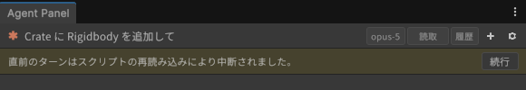

# Script recompiles and Play mode

[User guide](../USER-GUIDE.en.md) > Script recompiles and Play mode

- Changing a script triggers a domain reload. Just before it, the panel ends the CLI process and saves the session ID, then reconnects to the same session automatically afterwards (banner "Reconnecting to the previous session..." followed by "Session resumed."). Restarting the editor restores the previous session the same way.
- If a reload happens in the middle of a turn, the panel reconnects and then sends "Continue" by itself, and the agent carries on (the default; the conversation log says "Auto-continue"). With auto-continue turned off, the banner "The last turn was interrupted by a script reload." appears instead and waits for you to press "Continue".

  
- That is "Continue automatically after an interruption" under Settings > Unity integration > Unity operations (UapOps), on by default. It sends the continuation every time entering or leaving Play mode, or regaining focus after a script save, cuts a turn. Turn it off if you would rather look at each interruption before continuing. There is no cap on the number of times. It stops only when the CLI process has exited 4 times in a row and reconnection is suspended (see the "Reconnect" banner below), or when you press the stop button.
- After the agent writes and commits C#, it also waits for compilation to finish and keeps working by itself. That is "Continue automatically after a compile" in the same place, on by default: the panel sends a continuation turn carrying the compile result (shown in the conversation log). Turn it off if you would rather stop and look after each compile. If the continuation turn commits more scripts, it continues again after that reload too, so the write, compile, fix-errors loop can run unattended. There is no cap, and it stops under the same conditions as "Continue automatically after an interruption" (the agent stops committing, reconnection is suspended, or you press the stop button).
- To avoid turns being cut at every reload in the first place, turn on "Keep the agent running across script reloads (experimental)" in the same place (off by default, Claude Code only). The CLI then runs under a small helper process that is not stopped while Unity reloads. After the reload the panel attaches to the same process again, so there is no interruption banner and no "Continue": the turn simply carries on. The switch takes effect from the next connection. If the helper cannot be used, or the panel cannot attach again, it ends the process and reconnects as before. A Unity tool called while Unity has been away for more than 25 seconds returns a "still reloading" error (it was not run, and the agent can call it again).
- If Unity tools time out during Play mode, review "Enter Play Mode Settings" under Project Settings > Editor (Settings has an "Open Project Settings > Editor" button).
- If the CLI process dies, the banner "The agent process exited." and the reconnect button in the header appear. The panel reconnects automatically up to 3 times; after 4 consecutive exits it stops reconnecting and waits for "Reconnect" ([Troubleshooting](troubleshooting.en.md)).

---

[← Scene view markers, pins and sketches](scene-tools.en.md) · [User guide contents](../USER-GUIDE.en.md) · [Settings reference →](settings.en.md)
