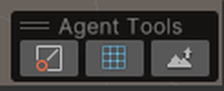
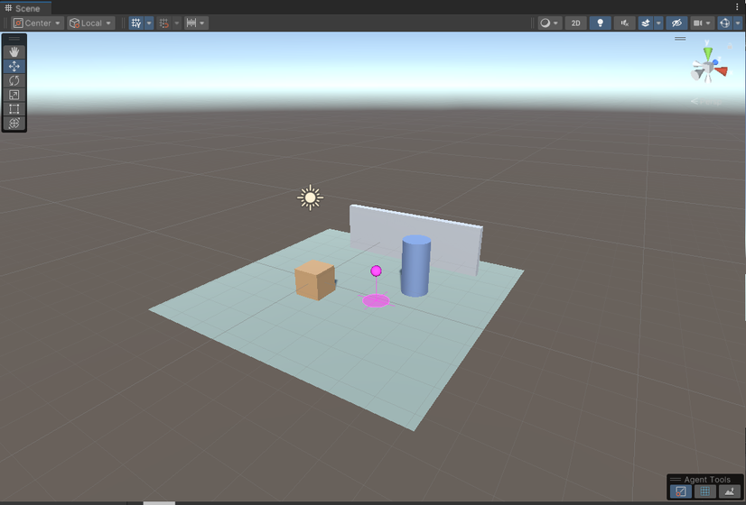
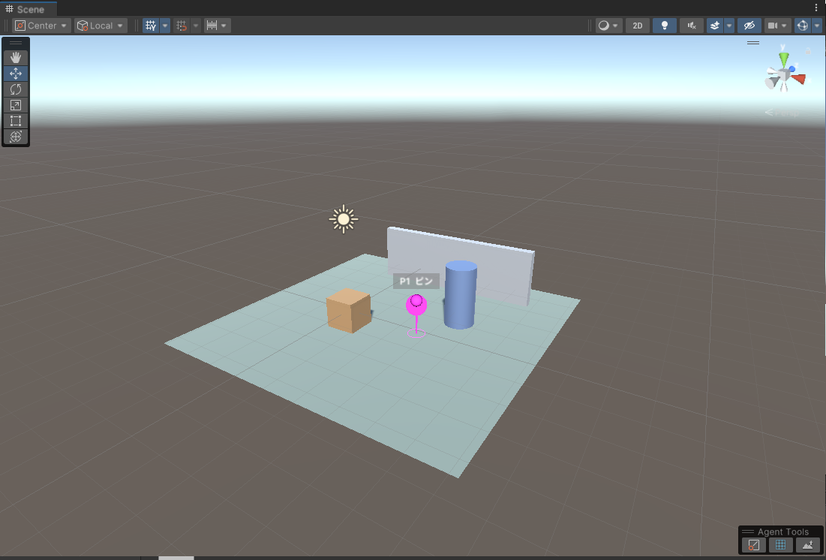
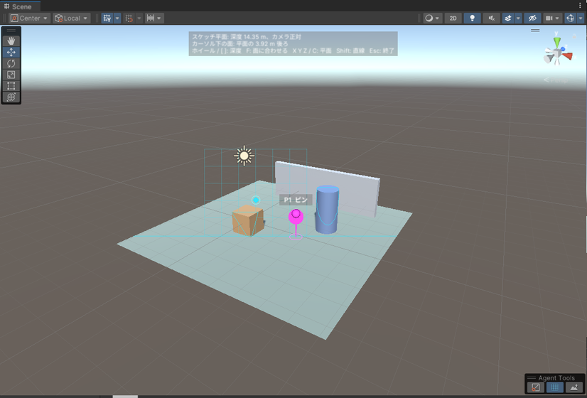
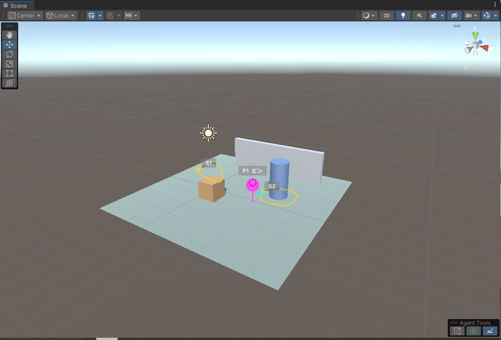
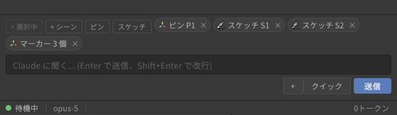
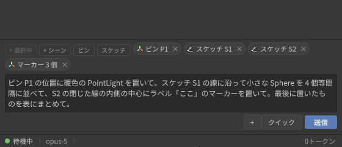
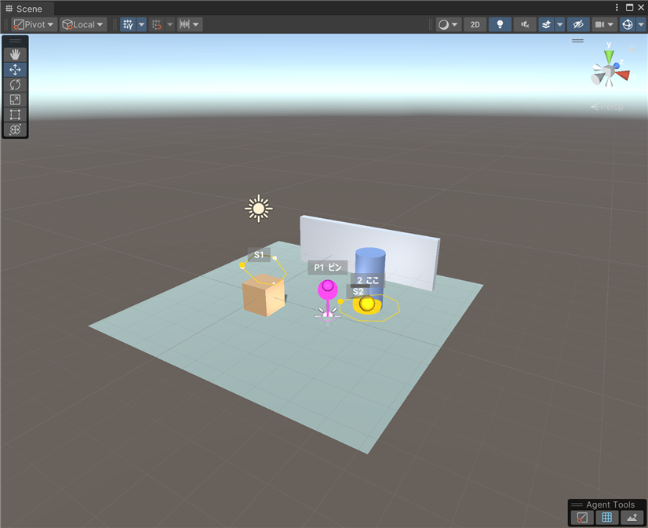
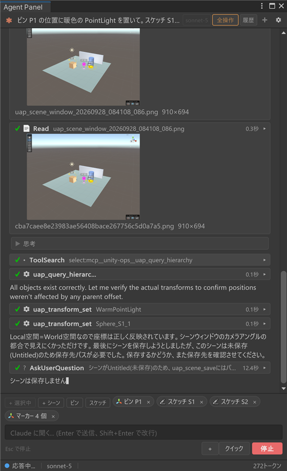

# Scene ビューのマーカー・ピン・スケッチ

[操作ガイド](../USER-GUIDE.md) > Scene ビューのマーカー・ピン・スケッチ

エージェントに「ここ」を伝える道具が 3 つあります。エージェント側が置く**マーカー**と、あなたが置く**ピン**、あなたが描く**スケッチ(線)**です。ピンとスケッチは Scene ビューの **Agent Tools** ツールバーかコンテキストバーから使います。

## エージェントからのマーカー

位置を示したいとき、エージェントは Scene ビューに球・矢印・ワイヤ箱・折れ線・ラベルなどの番号付きマーカーを置きます(`uap_marker_add` / `uap_marker_list` / `uap_marker_clear`)。マーカーは表示だけでシーンには保存されません。コンテキストバーの「マーカー N 個」チップの × でまとめて消せます。消さずに一時的に隠したいときは、同じチップの目のボタンか、Agent Tools ツールバーの「表示」トグル(後述)を使います。

## Agent Tools ツールバー

Scene ビューの右下に「Agent Tools」というツールバーが出ます。左からピン / 平面に描く / 表面に描くの 3 つのモードトグルと、右端に「表示」トグルです。モードは点灯するのが常に 1 つだけです(片方を選ぶともう片方は解除されます。同じ左クリックを取り合うためです)。コンテキストバーの「ピン」ボタンと「スケッチ」メニューも同じ状態を動かすので、どちらから入っても同じです。



- ほかのオーバーレイと同じく、ヘッダーをドラッグして好きな場所に移せます。Scene ビュー右上の ⋮ > Overlays(または `` ` `` キー)のオーバーレイメニューで非表示にもできます。非表示にしてもパネル側のボタンは使えます。
- **Esc** でどのモードも抜けます。

### 「表示」トグル(消さずに隠す)

右端の目のトグルは Scene ビューの **Gizmos** ボタンと同じ考え方で、エージェントの表示物(マーカー・ピン・スケッチ、Agent Panel Pro の Model 状態ラベル)を**消さずに隠します**。もう一度押せば元のまま戻ります。

- 隠している間もマーカーやピンはそのまま残り、コンテキストバーのチップは「マーカー N 個(非表示)」と表示します。チップの目のボタンでも同じ切り替えができます。
- エージェントには `uap_marker_add` / `uap_marker_list` の返事で「非表示中」と伝わり、`uap_editor_screenshot` にも載りません。
- 設定は Unity 全体の個人設定(EditorPrefs)なので、エディタを再起動しても隠したままです。マーカーが出ないときはこのトグルが消灯していないか確認してください。

## ピン

1. ツールバーのピントグル(またはコンテキストバーの「ピン」)を押します。カーソルの下に、置かれる位置の**プレビュー**(球と足元の円)が出ます。
2. Scene ビューを左クリックすると、その位置にピン(P1, P2, ...)が置かれ、コンテキストバーに「ピン P1」チップが出ます。チップは次の送信でエージェントに渡り、ワールド座標・クリックしたオブジェクト・近くのオブジェクト・Scene カメラの位置が伝わります。
3. 1 本置くとモードは自動で終わります。**Shift** を押しながらクリックすると連続で置けます。





## スケッチ(線)

平面か表面のトグル(またはコンテキストバーの「スケッチ」メニュー)で描画モードに入り、Scene ビューを**左ドラッグ**すると線(S1, S2, ...)が描けます。線はコンテキストバーに「スケッチ S1」チップとして出て、点列としてエージェントに渡ります(エージェントは `uap_stroke_list` で全点・法線・描いたオブジェクト・長さ・閉じているか・スケッチ平面を JSON で読めます)。フリーハンドの線は保存前に間引かれます(長さの 0.5% 未満の凹凸は落ちます)。

### 形

Agent Tools ツールバー右端の**形のドロップダウン**(またはコンテキストバーの「スケッチ」メニューの「形」サブメニュー、Scene ビューでの **1**〜**5** キー)で、次に描く形を選びます。

| 形 | キー | 描き方 |
|---|---|---|
| フリーハンド | 1 | 左ドラッグ。Shift で直線。 |
| 直線 | 2 | 端から端へ左ドラッグ。 |
| 折れ線 | 3 | **クリック**で角を置いていきます。最初の角をもう一度クリックすると閉じ、Enter(またはダブルクリック)で開いたまま確定。Backspace で 1 点戻し、Esc で折れ線ごと破棄。 |
| 矩形 | 4 | 隅から隅へ左ドラッグ。Shift で正方形。常に閉じます。 |
| 楕円 | 5 | 外接する箱を左ドラッグ。Shift で円。常に閉じます。 |

矩形は 4 隅、楕円は 48 点で保存されるので、エージェントには正確な角と曲線が渡ります(`uap_stroke_list` の `shape`)。表面モードでは形を 1 点ずつメッシュに落とすので、起伏のある地面に描いた矩形は地面に沿います。

### 描きながら視点を動かす

スケッチ中もホイール・右ドラッグ・中ドラッグ・Alt+ドラッグは Scene ビューの操作(ズーム・見回し・パン・回転)のままです。折れ線はクリックごとに角を置くので、クリックの合間にズームアウトや回転をして、画面より大きな範囲を囲めます。平面モードの深度は **Ctrl+ホイール**(macOS は Cmd)か `[` `]` です。Esc は描画中の線を破棄し、もう一度押すとモードを抜けます。

**平面に描く**は、先に深度を決めた平面に描きます。上に平面の深度・軸と、カーソル下の面が平面の何 m 前 / 後ろかの読み出しが出ます。平面が周囲のオブジェクトを切る位置に水色の**輪郭線**、カーソルの周りに深度テスト付きの**格子**が出るので、どの奥行きに平面があるかが分かります。

| キー | 働き |
|---|---|
| Ctrl+ホイール / `[` `]` | 深度を前後に(ホイールだけなら視点のズーム) |
| **F** | カーソル下の面の深度に合わせる |
| **X** / **Y** / **Z** | ワールド軸に固定した平面にする |
| **C** | カメラ正対の平面に戻す |
| **Shift** + ドラッグ | 直線(フリーハンド)/ 正方形・円(矩形・楕円) |
| **1**〜**5** | 形: フリーハンド / 直線 / 折れ線 / 矩形 / 楕円 |
| **N** | 最新のスケッチに名前を付ける |




**表面に描く**は、カーソル下のメッシュ表面に沿って描きます。描いたオブジェクトと各点の法線も一緒に伝わるので、「この面のここ」を渡すのに向きます。



### エリア: 閉じたスケッチに名前を付ける

閉じたスケッチ(矩形、楕円、最初の角で閉じた折れ線、一周したフリーハンド)は**エリア**です。線の色(S 番号ごとに別の色)で半透明に塗られ、**名前**を付けられます。Scene ビューの「S1」ラベルをクリック、チップを右クリックして「名前...」、またはスケッチ中に **N** で最新の 1 本に名前を付けます。名前はラベル(「S1 広場」)、チップ(「スケッチ S1: 広場」)、エージェントに渡る内容に出ます。

エリアについてはエージェントの `uap_stroke_list` が**面積**(m²)、**重心**、**中に入っているオブジェクト**(`contains`: bounds の中心が外形の内側にある表示中のオブジェクト。描いた地面と、外形より大きいものは除きます)も返します。既にあるワールドをエリア分けするときはこれを使います。表面モードで地面に矩形を描き(平面モードなら **Y** で水平面にして **F** で地面の高さに合わせる)、「広場」と名付け、次を描いて「森」と名付けてから、こう頼みます。

> 広場の中にベンチを 4 つ等間隔で置いて。森のエリアの中の木は 1.5 倍にして。

Pro のメッシュツールはこの線をそのまま使えます: 線に沿って溝を掘る / 盛り上げる(`uap_mesh_edit`)、線に沿ったチューブや、閉じた線の外形で穴をあける・板を貼る(`uap_mesh_create` の `sdf` / `extrude`)。

## チップと片づけ

置いたピンと描いた線は、コンテキストバーの「ピン P1」「スケッチ S1」チップになり、× で個別に消せます。「マーカー N 個」の数と「Scene ビューのマーカーとピンをすべて消す」はピンとスケッチも含みます。ピンとスケッチはドメインリロードを越えて残り、シーンの切替や Play で消えます。



## 使用例: ピンとスケッチで「ここ」を伝える

上の図の状態(ピン P1、平面スケッチ S1、表面スケッチ S2)で、こう頼みます。番号はチップのものをそのまま書けば通じます。

> ピン P1 の位置に暖色の PointLight を置いて。スケッチ S1 の線に沿って小さな Sphere を 4 個等間隔に並べて、S2 の閉じた線の内側の中心にラベル「ここ」のマーカーを置いて。最後に置いたものを表にまとめて。



送信すると、依頼文の後ろにチップの中身が付いてエージェントに届きます。たとえばピン P1 はこう伝わります。

```text
[1] Scene marker P1 (user-placed pin in the Scene view)
  world position: (2.20, -0.50, 0.61)
  hit object: Ground
  nearest objects: Ground (1.3m), Barrel (1.9m), Crate (2.3m)
  scene view camera: position (8.76, 6.40, -10.12), pivot (1.50, 0.30, 1.50)
```

スケッチは点列・長さ・閉じているか・平面(平面モード)/ 描いたオブジェクト(表面モード)が付き、点が多いときは `uap_stroke_list` で法線付きの全点を読めます。この例でエージェントが受け取る全文と、`uap_marker_list` / `uap_stroke_list` の出力は [docs/examples/agent-tools-request.md](../examples/agent-tools-request.md) にそのまま載せています。

実際に送った結果(Claude Sonnet、自動承認レベル「Unity 操作をすべて」)。エージェントは P1 の座標に `WarmPointLight` を作って Light を付け、S1 の点列を弧長で 3 等分した 4 点に小さな Sphere を置き、S2 の 13 頂点の平均にラベル「ここ」のマーカーを置いてから、Scene ビューを撮って確認し、表にまとめました。





エージェントが返した表はこうです(返答の全文は同じ例のページに載せています)。

| # | 種類 | 名前 | ワールド座標 | 備考 |
|---|------|------|--------------|------|
| 1 | Point Light | WarmPointLight | (2.20, -0.50, 0.60) | ピンP1の位置。色温度2700K(暖色)、Intensity 1.5、Range 8 |
| 2 | Sphere | Sphere_S1_1 | (-0.64, 1.05, -0.27) | S1線上、始点(1/4) |
| 3 | Sphere | Sphere_S1_2 | (0.24, 1.26, 0.38) | S1線上、弧長1/3地点 |
| 4 | Sphere | Sphere_S1_3 | (0.41, 0.45, 0.06) | S1線上、弧長2/3地点 |
| 5 | Sphere | Sphere_S1_4 | (-0.61, 0.97, -0.30) | S1線上、終点(4/4) |
| 6 | Sceneマーカー | ラベル「ここ」 | (3.03, -0.32, 1.84) | S2閉曲線内側の重心(頂点平均) |

途中、シーンが未保存(Untitled)だったため `uap_scene_save` が保存先を求め、エージェントは保存するかを AskUserQuestion で尋ねています。自動承認レベルにかかわらず、この質問だけは必ずカードになります([自動承認レベル](permissions.md#自動承認レベル))。

---

[← Unity 操作ツール(UapOps)](unity-ops.md) · [操作ガイドの目次](../USER-GUIDE.md) · [スクリプトの再コンパイル・Play モードとの共存 →](reload-and-play-mode.md)
