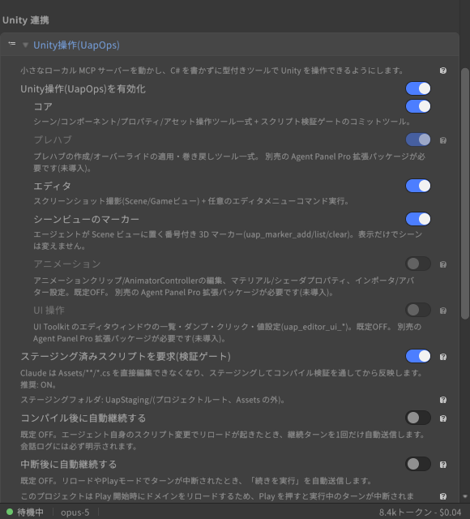

# Unity 操作ツール(UapOps)

[操作ガイド](../USER-GUIDE.md) > Unity 操作ツール(UapOps)

パネルは内蔵の MCP サーバ(ローカルループバック限定・トークン認証)を通じて、エージェントに Unity エディタを直接操作させることができます。設定 > Unity 連携 > Unity操作(UapOps) の「Unity操作(UapOps)を有効化」を ON にし、使うモジュールを選びます。

| モジュール | できること |
|---|---|
| **コア** | シーンオブジェクトの作成・検索・inspect、コンポーネント追加、プロパティ/Transform の設定、アセット操作、メニュー実行、スクリプトのステージングとコミット、プロジェクトの再コンパイルとエラー一覧の取得(`uap_compile`。外部エディタで直接書き換えたあとの再確認用。エージェント自身が書くスクリプトは従来どおり `uap_scripts_commit` で検証してから入ります)、登録済みツールの詳細(説明とスキーマ)を名前で引く `uap_help`、コンポーネントのフィールド/プロパティを一定間隔で読み続けて変化を時系列で返す `uap_game_watch`(指定は `uap_object_inspect` と同じ、`velocity.y` のようなドット区切りも可、1 回最大 6 秒、既定は変化したサンプルと最初・最後だけ、`until` で「0 になった時点」などの条件停止。読み取り専用) |
| **プレハブ**\*(Agent Panel Pro) | プレハブ作成、オーバーライドの一覧・適用(Apply)・巻き戻し(Revert)、Prefab Mode の開閉。プレハブの中身を編集したいときはステージを開きます(開いている間、他のツールはシーン名を省略するとそのステージを指します)。閉じると保留中の編集はプレハブに書き込まれます。既にプレハブインスタンスになっているものから作成すると Unity の仕様で Variant になり、結果にどちらを作ったかが出ます |
| **エディタ** | Scene / Game ビューのスクリーンショット(`annotate_ui:true` でクリック・ドラッグできる uGUI 要素を、階層パス・種類・表示テキスト・`uap_game_pointer` と同じ座標付きで一覧。`ui_only:true` なら画像を省いて一覧だけ)、任意のエディタメニューの実行、Play モードの開始・停止・一時停止・1 フレーム送り(`uap_play_mode`)、Unity コンソールのログ読み取り(`uap_console_logs`)とクリア(`uap_console_clear`)、Game View の解像度の取得・変更(`uap_game_view_size`。一覧に無いサイズは「Agent Panel 1920x1080」のような名前でドロップダウンに追加されます)、Play 中のゲームへの入力(`uap_game_pointer`: uGUI のボタン・スライダーなどのクリック / 長押し / ドラッグ。階層パスかスクリーンショット座標で指定。`uap_game_key`: Input System 経由のキー押下・保持・解放。旧 Input Manager には注入口が無いため Input System を使うプロジェクトのみ。`uap_game_mouse`: `Mouse.current` を直接読むゲームコード向けのクリック・長押し・移動・移動量・スクロール。`dry_run:true` なら Play モードも Input System も不要で「その座標に 3D / 2D で何があるか」だけを確かめられます)、プロジェクト情報の取得(`uap_project_info`: Unity バージョン、ビルドターゲット、Active Input Handling、Enter Play Mode Settings、Run In Background、このパネルの挙動を左右するパッケージの有無を 1 回で返す。読み取り専用)、エディタを最前面に戻す `uap_editor_focus`。Game / Scene ビューの動画記録(`uap_record_video`: `start` ですぐ返り、録画は裏で進むので他のツールも使えます。`stop` でファイルを確定。Windows・macOS は mp4、Linux は webm、最長 300 秒。ドメインリロードで録画は止まるため、ゲームを撮るときは Play モードに入ってから開始)、入力の記録と再生(`uap_input_record` / `uap_input_replay`: Play 中のキーボード・マウス操作を時刻付きで `Library/UnityAgentPanel/InputRecordings/` の JSON に残し、同じ操作を 0.25〜4 倍速で再生。再生の終了・中断・Play 終了時には押したキーとボタンをすべて離します。Input System が必要)。ライトマップベイク(非同期・プリフライト診断)と Bakery GPU Lightmapper 連携\*(Agent Panel Pro) |
| **動的コード** | 型付きの `uap_*` ツールでできない操作のための C# 実行 `uap_execute_code`(uLoop の execute-dynamic-code 相当)。エージェントが書いたメソッド本体を裏でコンパイルし(エディタは止まりません)、プロジェクトのアセンブリを参照して実行、戻り値と実行中の `Debug.Log` を返します。**権限カードに必ずコード全文が出て、どの自動承認レベルでも省略されません。** プロセス起動・通信・ファイルやアセットの削除・名前によるリフレクション・無限ループなどを検出したときは、最初の呼び出しでは何も実行せず検出内容だけを返し、`confirm:true` での再呼び出しで初めて実行します(検出は目安であり、サンドボックスではありません)。実行は 1 つの Undo グループにまとめ、Ctrl+Z で戻せる変更があったかを返答で知らせます。実行したコードは次のドメインリロードまでメモリに残るため、32 件を超えると `action:"reset"`(再読み込み)を勧めます。設定のモジュール切替で「動的コード」だけを無効にできます(既定は有効) |
| **アニメーション**\*(Agent Panel Pro、既定 OFF) | AnimationClip 作成(float / GameObject の ON・OFF / スプライト等の差し替えカーブ、キー補間指定)、AnimatorController 編集(パラメータ/ステート/遷移/レイヤー/サブステートマシン/Entry・Exit/Write Defaults/Motion Time、遷移の詳細設定、要素の削除)、BlendTree(1D / 2D / Direct)の作成・編集、StateMachineBehaviour の付与・設定・削除、AvatarMask と AnimatorOverrideController の作成・編集、マテリアル/シェーダプロパティ、アセットプロパティ設定、インポータ設定 |
| **UI 操作**\*(Agent Panel Pro、既定 OFF) | UI Toolkit ウィンドウの一覧・ダンプ・クリック・値設定によるエディタ UI 自動操作 |
| **プロファイル作成**\*(Agent Panel Pro、既定 OFF) | このプロジェクト用の拡張プロファイル(`.uap-profiles/*.json`)の下書きと検証。導入済みパッケージの型を実際に走査して検出条件を書き、指示文だけを TODO として残します。作成しただけでは注入されず、拡張プロファイルの一覧での承認が必要です。Claude Code のスキル(`.claude/skills/<name>/SKILL.md`)の書き出しも同じモジュールです |
| **アバター計測**\*(Agent Panel Pro、既定 OFF) | アバターの三角形数・マテリアルスロット・レンダラ・ボーン・ブレンドシェイプ・PhysBone / Contact / Constraint・欠損スクリプトを計測。2 つ目の階層(ベイク済みクローンなど)を渡すと統計ごとの差分を返します。VRChat SDK があれば PC / Quest のパフォーマンスランクも読み取ります。NDMF の manual bake を実行してクローンとの差分まで一度に出すこともできます(生成物を書くため確認付き)。エキスプレッションメニューとパラメータの読み書きもこのモジュールで、書き込み前に VRChat SDK の規則(1 メニューのコントロール上限、256 bit の同期パラメータ予算、パペットの軸パラメータ数、存在しないパラメータを指すコントロール)を全件検証します |
| **一括実行**\*(Agent Panel Pro、既定 OFF) | 複数の Unity 操作を 1 回の呼び出し・1 枚の許可カードでまとめて実行します。実行前に全件を検証するため、1 件でも不正なら何も実行されません。破壊的な操作(プレハブの Apply など)と、OFF にしているモジュールのツールは含められません |
| **テスト実行**\*(Agent Panel Pro、既定 OFF) | プロジェクトの EditMode テストを Unity Test Runner で実行し、失敗したテストの名前・メッセージ・スタックを返します。アセンブリ名・正規表現・テスト完全名・カテゴリで絞れます。実行せずに「どんなテストがあるか」だけを返すこともできます(フィルタを当てずっぽうで書かずに済みます)。フィルタが 1 件も当たらなかった実行は「0 件」として報告されます(Test Runner 自身はそれを成功として報告するため)。PlayMode には対応していません。この行は `com.unity.test-framework` が入っているプロジェクトでのみ有効になります |
| **パーティクル**\*(Agent Panel Pro、既定 OFF) | Particle System のモジュールをスクリプト上の名前(`main` / `emission` / `shape` / `colorOverLifetime` ...)で読み書きします。シリアライズ名は別物(Inspector の「Main」はファイル上 `InitialModule`、Duration はそこに無く最上位の `lengthInSec`、形状は enum 名の無いただの整数)なので、そちらを覚える必要はありません。カーブ値はモードを値と同時に決めるため「数値のつもりがカーブの倍率になっていた」が起きず、OFF のモジュールへの書き込み(Unity は受け付けたうえで何もしません)と、もう効果の無い古いプロパティは拒否します。バーストの設定もここから行えます |
| **メッシュ生成**\*(Agent Panel Pro、既定 OFF) | コンパイル不要のメッシュ操作と非破壊モデル。`uap_mesh_create` は数値からメッシュを生成します: 箱・平面・円柱・円錐・球・トーラス・階段、XZ 外形の押し出し、XY プロファイルの回転体、SDF ツリー(球・箱・カプセル・円柱・トーラス・楕円体を union / intersect / subtract で合成、`smooth` で継ぎ目を丸める = 有機的な形と滑らかなブーリアン)、頂点列そのまま(`raw`)。`assetPath` で Mesh アセットに保存、`place` で MeshFilter + MeshRenderer(任意で MeshCollider)を持つ GameObject までシーンに作ります。`uap_mesh_inspect` は既存メッシュの頂点数・bounds・保存場所・閉じているかを返し、範囲内や最寄りの頂点を一覧します。`uap_mesh_edit` は既存メッシュを範囲(球 + 減衰 = プロポーショナル編集、箱、全体)で編集します: 移動・膨らませ・平滑化・細分化・ノイズ。Unity 組み込みやインポート済みのメッシュは `detach:true` でコピーしてから編集します。`uap_mesh_boolean` は閉じた 2 メッシュの union / intersect / subtract を新しいメッシュとして作ります(入力は変更しません)。生成系は新規作成のみで既存アセットを上書きしません。`uap_mesh_validate` は退化・重複三角形、非多様体エッジ、巻き方向の食い違い、開いた辺(意図的なことが多いので既定では情報扱い)、法線の向き違い、内向きに揃った面(スカイボックスなどは情報扱い)、同一平面の重なりを重大度つきで報告し、`uap_mesh_repair` はそれらを選んで修復します(既定は形を変えない安全な組み合わせ。溶接・重なり除去・穴埋めはオプトイン、Ctrl+Z 可)。`uap_scene_zfight_scan` はシーン内の別オブジェクト同士で同一平面に重なる面(Z ファイティング)を一覧し、対処案を示します。`uap_mesh_export` / `uap_mesh_import` は glTF(.glb / .gltf)でメッシュを書き出し・取り込みし、外部ツール(Blender、Python のメッシュカーネル、生成 AI)と往復できます。`place.checkZFight: true` で配置直後の照合もできます。非破壊モデル: `Model` コンポーネントの下に `Model Node`(距離場の形状。Transform で位置、`fold` / `smooth` で子と合成)を階層で置いたものを、`uap_model_inspect`(木を JSON で読む。ノード id・署名・前回からの変更・古さ・任意点の符号付き距離)、`uap_model_apply`(パッチで編集。1 回 = 1 Undo)、`uap_model_evaluate`(疎なブリック格子 + dual contouring で根の MeshFilter にメッシュ化)で扱います。ノードにはミラー・反復・殻・オフセット、スケッチ線のチューブ形状、任意の Unity Mesh を距離場にする形状(ベベルとクリース付き Catmull-Clark 細分割のケージ修飾つき)があり、`Live` のモデルは編集のたびにプレビュー、静止後に本メッシュ化します(人の編集は編集ログに残り AI が読めます。プロジェクトに Burst があれば評価は自動で Burst 版になります)。モデルのスクリプト(`var` / `bind`)でノードの値を式に追従させれば、1 つの数で全体が変わるパラメトリックなモデルになります。ノードの `material` / `color` で評価結果がサブメッシュと頂点カラーに塗り分けられ、1 メッシュに必要な数だけのマテリアルを使えます(`uap_mesh_create` の `color` / `colors` / `uv2`、配置の `materials`、glTF の頂点カラーも対応)。`uap_model_bake` はデシメーション・UV 展開・距離場からの法線 / AO ベイク・アセット書き出しまでを 1 回で行います(`remesh: true` なら曲率・稜線・マテリアル境界に沿う四角形主体メッシュに作り直して四角形ケージも書き、`output: "cage"` なら距離場の四角形をそのまま四角形トポロジーの Mesh に書きます)。`uap_mesh_remesh` は任意のメッシュを目標面数の四角形主体メッシュに作り直します。`uap_cage_edit` はケージ Mesh を押し出し・インセット・ループカット・ブリッジ・三角形→四角形で編集し(四角形トポロジーのまま)、メッシュ葉の `edges` は辺の両端の座標でクリース・ベベル・シャープを指定します。ノードの `displace` + `falloff` は減衰つきの変位ブラシです。`uap_forge_migrate` は Forge のシーンを非破壊モデルに移行します。`uap_material_create`(プリセット `lit` / `unlit` / `vertexColor` をパイプラインに合わせて解決、近道とプロパティ、`reuse` で共有)、`uap_texture_create`(単色・グラデーション・チェッカー・ストライプ・ノイズ・パレットアトラスの PNG とインポート設定)、`uap_shader_create`(同梱雛形の書き出し: 頂点カラー・窓の interior mapping・デカール・フリップブック・トリプラナー)でマテリアル側のアセットも作れます。`uap_texture_create` の `cubemap` は窓用の室内、`uap_particle_set` の `preset` は煙・炎・火花・雨・塵の 1 式です。ノードごとに `material` / `color` を分けた評価結果は、所有ノードが切り替わる正確な位置で三角形を切るので、マテリアルの境界が格子状に汚れません |
| **シーンビューのマーカー** | Scene ビューに番号付き 3D マーカーを置く(表示のみ。シーンは変更しない) |
| **Web 取得** | エージェントが URL の中身を取得する `uap_web_fetch`。PNG / JPEG は縮小して画像として返し(ツールカードにサムネイル)、GIF / WebP はそのまま、PDF やその他のファイルは `Library/AgentPanel/Downloads/` に保存してパスを返し(Claude Code は `Read` で PDF を読めます。`as:"text"` や `pages:"1-5"` を付けるとパネル側で本文テキストを抽出して返すので、PDF を読めないエージェントでも中身が分かります。レイアウトは平坦化され、画像やスキャンだけのページは空になります)、HTML は本文テキストとページ内の画像 URL・リンク URL の一覧にします。エージェント自身の Web 取得ツールはテキストしか返せないため、「検索で見つけた画像や PDF を見せる」にはこちらを使います。`save_to` を付けると `Assets/` 配下に直接保存してインポートします(「このテクスチャを取ってきてマテリアルに貼って」が 1 手で済みます。既存ファイルは `overwrite` 指定がなければ上書きしません)。公開ホストのみ(localhost・LAN・リンクローカルは拒否)、20 MB まで、Cookie や認証ヘッダは送りません。設定の「許可するホスト」「拒否するホスト」(1 行 1 ホスト、サブドメイン含む)で取得先をさらに絞れます。同じモジュールの `uap_web_search` は、自前の Web 検索を持たないエージェント向けの検索です。設定の「検索プロバイダ」(Brave Search API / Tavily)と「検索 API キー」を入れると使え、タイトル・URL・スニペットを返します(キーが無いときはその旨をエージェントに伝えるだけで、外部には何も送りません)。プロジェクトは変更しませんが外部へ通信するため、読み取り専用の自動承認の対象外で、毎回 URL を示した権限カードが出ます(「常に許可」で省略できます) |

\* 印のモジュールは別売パッケージ Agent Panel Pro(`jp.colloid.agent-panel-pro`)が必要です。未導入の間は該当トグルが無効化され、ヒントに「別売の Agent Panel Pro 拡張パッケージが必要です(未導入)」と出ます。Pro の導入は 設定 > Agent Panel Pro の更新([設定画面リファレンス](settings.md))に購入時のレジストリ URL と製品キーを入れるだけで、次のドメインリロード後にトグルが有効になります。印のないモジュールは Core だけで使えます。

使い方のポイント:

- 依頼は普通の言葉でかまいません(例: 「選択中のオブジェクトの子に PointLight を追加して強度を 3 にして」)。エージェントが対応する `uap_*` ツールを選び、権限カードを経て実行します。
- **動かして確かめる**: 「直したら実際に動かして確認して」と頼めば、エージェントが Play モードを開始し(`uap_play_mode`)、ゲームが出したログを読み(`uap_console_logs`)、終わったら停止します。Play モードの出入りはドメインリロードを伴うため、エージェント側は切り替わりを待ってから状態を確認する作りになっています。コンパイル中は実行を断ります。Player Settings の Run In Background が OFF の場合、Play 中にエディタからフォーカスを外すと Unity 操作がタイムアウトすることがあります(開始時に警告が出ます)。その場合エージェントは `uap_editor_focus` でエディタを最前面に戻せます(Windows / macOS、Linux は `wmctrl` があるとき)。値が時間とともにどう変わったか(HP が 0 になったか、速度が落ち着いたか)は `uap_game_watch` 1 回で、複数手順の操作の様子は `uap_record_video` の動画で、証拠付きで確認できます。
- **ツール一覧のモード**(設定 > Unity 連携 > Unity操作(UapOps) の「ツール一覧のモード」): **フル**は有効なモジュールの全ツールを従来どおり一覧します。**コンパクト**はコアモジュールのツールだけを直接一覧し、他の有効モジュールのツールは `uap_tools`(名前・モジュール・一行要約で検索)と `uap_call`(見つけたツールを名前で実行)を経由して使います。直接一覧されないだけで、実行できるツール・権限カード・Undo の扱いは直接呼んだときと同じです。ツールの説明文はセッションの最初に毎回エージェントへ渡るため、Claude Code 以外(ツールを必要になってから読み込む仕組みを持たないエージェント)ではこれが毎回の固定費になります。既定の**自動**は Claude Code ではフル、それ以外ではコンパクトを選びます。反映は次の接続からです。コンパクトの一覧に載るツールの入力スキーマは各項目の説明を 1 文に縮めた軽量版(型・必須項目・選択肢などはそのまま)で、完全なスキーマは `uap_help` の `names:[...]` で取れます。
- **手順のプレイブック**(`uap_help` の `topic`): 「Play で動作確認する」「uGUI のボタンを押す」「スクリプトを直してコンパイルを確認する」「入力を記録して再生する」「`uap_execute_code` を使うべきか」といった複数ツールにまたがる手順は、エージェントが必要になったときだけ `uap_help topic:"verify-gameplay"` のように取り寄せます。常に渡す指示文に載せるのは、使えるプレイブックの ID を並べた 1 行だけです。どのエージェント(Claude Code・Codex・Gemini など)でも同じように動き、プロジェクトにファイルは作られません。使えるのは、手順に出てくるツールがすべて有効なモジュールにあるものだけです。
- **Undo**: 1 ターン分の Unity 操作は Ctrl+Z 1 回でまとめて元に戻せます。
- **スクリプト検証ゲート**(「ステージング済みスクリプトを要求(検証ゲート)」): エージェントが書く C# はまず一時フォルダに置かれ、コンパイルが通ったものだけが `Assets/` に入ります。壊れたコードでドメインリロードが起きることはなく、コンパイルエラーはエージェントに返って自己修正されます。フック層は Windows のみで動作します。
- **取り消せない操作**(アセット削除、Pro ではプレハブへの Apply も)は、エージェントが `confirm:true` を付けるまで実行されず、影響範囲(削除対象、他のインスタンス数)だけが返ります。実行前に会話で内容を確認してください。
- **時間のかかる操作**(Pro のライトマップベイクなど)はジョブになり、エージェントが `uap_job_status` で後から結果を取得します。Editor が処理中でも応答は返ります。
- **拡張プロファイル**(設定 > Unity 連携 > 拡張プロファイル): 検出したサードパーティ SDK の要点をエージェントの指示に追加します。
  - プロジェクト独自のプロファイル(プロジェクト直下の `.uap-profiles/*.json`)は Core だけで使えます。「確認して承認」で全文を確認してから有効になります。
  - VRChat SDK3(共通 / アバター / ワールド)/ Udon / UdonSharp / NDMF / Modular Avatar / VRCFury / Avatar Optimizer / lilycalInventory / lilToon / UniVRM / MagicaCloth2 / Final IK / Bakery / RPG Maker Unite / ProBuilder を自動検出する同梱プロファイルは Pro に収録されています。Pro 未導入のプロジェクトでは、対応 SDK が入っていても検出されず、その旨がこの欄に表示されます。
- **uLoop 連携**(設定 > Unity 連携 > uLoop連携): このパネルの `uap_*` ツールが uLoop の機能をひととおり賄えるため、**uLoop が入っているプロジェクトにだけ** カードを表示します(入っていなければ、設定に uLoop の項目は出ません。パネルから uLoop を導入するボタンもありません)。カードの中身は次の 3 つです。
  - **注意書き 1 行**: 「uLoop が入っています。このパネルの Unity ツールで代替できるため、パネル外で使わなければ削除を推奨します。」ホバーで詳細が出ます。uLoop はエディタ側サーバと 16ms ごとのティックポンプを動かし続け、エージェントの毎セッションにスキルの説明文(約 5.7KB ≒ 1.5〜2k トークン、2026-09-21 に uLoop 3.6.3 で計測)を載せます。**これらはこのパネルからは止められません**(uLoop 側の持ち物です)。弱めるなら `Window > Unity CLI Loop`、完全に止めるにはパッケージの削除です。
  - **エージェントに uloop コマンドを使わせる**(トグル。**新しい設定では既定オフ**): オフにすると、(1) エージェントへの指示文に「uloop は拒否される」と明記し、(2) 次の接続の起動引数に各シェル用の拒否パターンを足し、(3) それでも届いた uloop コマンドを拒否して、代わりに使う `uap_*` ツールを会話に表示します。オンにすると、`uap_*` で表現できない操作の逃げ道として uloop を残します。反映は次の接続からです(許可/禁止ツールリストと同じ)。**これはエージェントの利用を止めるだけで、uLoop 自体は止まりません。** 以前の版で保存済みの値(既定がオンだった)は、そのまま保たれます。
  - **削除**(「uLoop を削除」ボタン): 常駐を本当に止められるのはパッケージを外すことだけなので、削除導線を用意しています。**変更内容(manifest.json の差分)を先に表示** し、`.uap-backup` を取ってから書き込みます。依存の削除は Unity が行い、このパネルは **自分が追加した OpenUPM の設定だけ** を片付けます(自分が書いていない広いスコープ・他のパッケージがまだ使っているスコープ・OpenUPM 以外のレジストリには触れません)。片付けは削除が終わってから走る 2 段目で、ここが失敗しても削除自体は成功のまま「manifest.json に設定が残っています」と表示します。設定側の `uloop` 許可行や指示スニペットは残ります(確認カードにも明記)。削除が終わるとカードは消えます(結果の表示が終わるまでは残ります)。設計: `docs/design-notes/2026-09-22-uloop-remove-from-panel.md`、`docs/design-notes/2026-10-02-uloop-card-final.md`。
  - Play モード操作・コンソールのログ読み取りとクリア・スクリーンショット・Play 中のゲームへのクリックとキー入力・スクリプトのコミット・テスト実行は、このパネル自身の `uap_*` ツールで賄えます(uLoop なしでも困りません。hot-reload / pause-point は Agent Panel Pro、execute-dynamic-code 相当は `uap_execute_code` です)。詳細と計測値: `docs/design-notes/2026-09-21-uloop-always-loaded-cost.md`。

---

[← セッション・履歴・モデル](sessions-and-models.md) · [操作ガイドの目次](../USER-GUIDE.md) · [Scene ビューのマーカー・ピン・スケッチ →](scene-tools.md)
